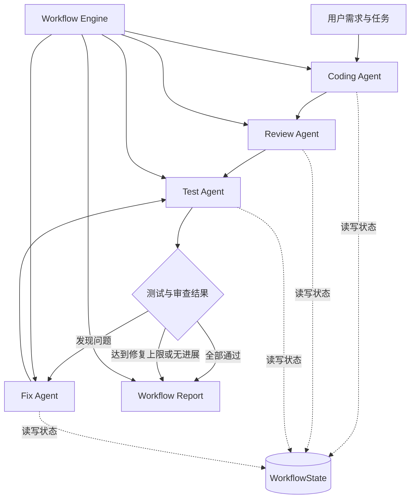
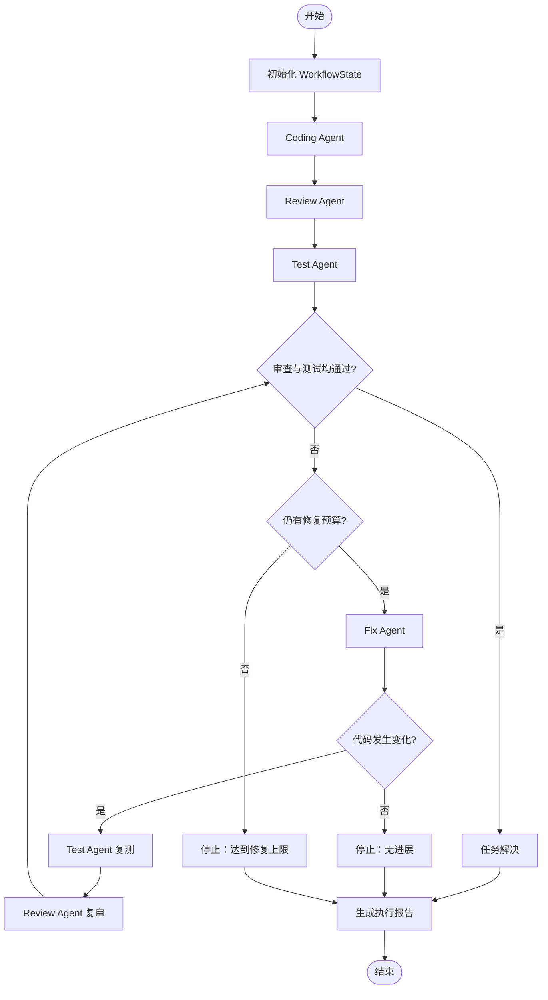

# Intelligent Agent Workflow 设计文档

## 1. 项目目标

本项目实现一个基于多 Agent 协作的代码审查工作流系统，通过统一的 Workflow Engine，将代码生成、代码审查、自动化测试和代码修复组织为完整的执行流程。

项目重点探索以下核心概念：

1. **Agent 协作：** 不同 Agent 负责独立任务，并通过统一接口协同工作。
2. **状态共享：** 使用统一的 WorkflowState 管理代码、审查结果、测试结果和修复记录。
3. **流程编排：** 通过 Workflow Engine 控制节点执行顺序及后续路由。
4. **条件分支与循环：** 根据审查和测试结果决定是否继续修复。
5. **错误处理与恢复：** 记录执行异常、保留已有结果，并限制自动修复次数。
6. **执行日志与报告：** 追踪各阶段状态、执行耗时、路由选择和最终结果。

本项目以 Python 代码生成、审查、测试与修复为主要应用场景，同时将通用 Workflow 能力与具体代码审查逻辑分离，为后续扩展其他 Agent 和流程节点提供基础。

## 2. 总体架构

系统采用分层设计，将 Agent、工作流编排、共享状态和结果报告分开管理。



### 2.1 架构分层

| 层次 | 主要模块 | 职责 |
|---|---|---|
| Agent 层 | `coding_agent.py`、`agent.py`、`test_agent.py`、`fix_agent.py` | 分别完成代码生成、审查、测试和修复 |
| Workflow 层 | `workflow/` | 管理节点执行、条件路由、状态提交、循环及异常处理 |
| 状态与数据层 | `models.py`、WorkflowState 及相关数据模型 | 保存共享数据、执行状态、结果和历史记录 |
| 工具与供应商层 | `code_checker.py`、`file_editor.py`、`llm.py` 等 | 提供代码检查、补丁处理及模型调用能力 |
| 报告与验证层 | `workflow/report.py`、`tests/`、`demo.py` | 汇总执行结果、验证工作流行为并展示完整流程 |

系统的核心设计原则是：**Agent 负责具体任务，Workflow Engine 负责流程控制，WorkflowState 负责共享数据，报告模块负责汇总结果。**

## 3. Agent 职责与协作机制

系统将复杂任务拆分为多个职责明确的 Agent。内置 Agent 通过统一接口接入 Workflow Engine，避免将所有逻辑集中在一个执行函数中。

### 3.1 Coding Agent：代码生成

主要文件：`coding_agent.py`

主要职责：

- 接收用户需求和可选上下文。
- 调用代码生成器生成 Python 源代码。
- 验证生成结果的数据结构和基本语法。
- 将生成代码及生成结果写入共享状态。
- 将代码交给后续审查和测试节点。

核心接口包括：

- `CodingAgent.execute(StateView) -> AgentResult`
- `CodingAgent.generate(requirements, context=...)`

代码生成结果使用 `CodeGenerationResult` 等结构化数据表示。代码通过 AST 语法解析并不代表业务逻辑一定正确，因此仍需要后续测试和审查。

### 3.2 Review Agent：代码审查

主要文件：`agent.py`、`review_policy.py`、`llm.py`

主要职责：

- 检查当前代码是否符合用户需求。
- 综合代码检查结果、测试结果和相关上下文。
- 识别明确的代码问题及阻断任务完成的问题。
- 生成结构化的审查报告。
- 为修复节点提供问题描述和必要证据。

审查报告使用 `ReviewReport`、`ReviewIssue` 等结构化模型。

审查结果还会区分阻断问题与非阻断建议，避免将需求范围之外的改进建议直接当作必须完成的修复任务。

系统保留 `CodeReviewAgent` 作为 `ReviewAgent` 的兼容名称，以支持原有调用方式。

### 3.3 Test Agent：自动化测试

主要文件：`test_agent.py`、`test_feedback.py`

主要职责：

- 读取当前代码和相关需求。
- 通过测试生成器产生测试用例，或在复验阶段复用原有测试用例。
- 在独立子进程中执行测试。
- 汇总通过、失败、运行错误和超时等结果。
- 将测试结果和失败证据写入共享状态。

测试结果通过 `TestExecutionResult` 等结构化数据表示。

测试失败属于工作流需要处理的业务结果，并不必然意味着 Workflow Engine 自身执行失败。Engine 可以继续根据测试结果进行条件路由。

### 3.4 Fix Agent：自动修复

主要文件：`fix_agent.py`

主要职责：

- 读取当前代码、审查报告和测试失败信息。
- 根据问题证据生成修复后的代码。
- 验证生成结果的结构和 Python 语法。
- 记录修改前后的代码、差异及修复说明。
- 将有效的修复结果提交给共享状态。
- 在代码发生变化后触发重新测试和审查。

修复 Agent 不以模型自行声称成功作为验收依据。修复是否有效，需要由后续测试和审查确认。

### 3.5 Agent 统一接口

`workflow/` 提供通用的 Agent 协作接口：

- `Agent` Protocol 定义 `name` 和 `execute(StateView) -> AgentResult`。
- `BaseAgent` 为内置 Agent 提供统一的执行模板。
- 内置 Agent 在 `run()` 中实现具体业务逻辑。
- `AgentResult` 用于返回执行结果和状态变更。
- `StateView` 为 Agent 提供只读的状态快照。

第三方 Agent 可以实现相同的 Protocol，而不必继承特定的基类。该设计降低了新增 Agent 时与既有实现之间的耦合。

## 4. Workflow 编排与执行流程

### 4.1 基本执行流程

完整的工作流包含以下阶段：

1. 初始化共享状态和运行元数据。
2. 执行 Coding Agent，生成初始代码。
3. 执行 Review Agent，检查需求一致性和代码问题。
4. 执行 Test Agent，验证代码行为。
5. 根据审查结果、测试结果和修复预算选择后续节点。
6. 如果需要修复，则执行 Fix Agent。
7. 代码发生变化后，重新执行测试和审查。
8. 根据最终结果、预算和异常情况结束工作流。
9. 生成最终执行报告。



### 4.2 Workflow Engine

主要实现位于 `workflow/`。

`WorkflowEngine` 负责：

- 按照配置执行工作流节点。
- 为 Agent 提供当前状态的只读快照。
- 校验 Agent 返回的结果。
- 在节点成功执行后统一提交状态变更。
- 选择下一个执行节点。
- 记录阶段状态、Agent 执行记录和路由事件。
- 在出现异常时保留失败状态并提供异常信息。

Engine 支持以下路由方式：

1. 固定后继节点 `next_step`。
2. Agent 返回的动态 `next_step`。
3. 根据状态计算下一节点的 `router`。

路由优先级为 Agent 返回的动态决策、Router 决策、固定后继节点。

这种设计同时支持简单顺序工作流和包含条件分支、循环的复杂工作流。

### 4.3 单轮工作流与自动修复工作流

项目保留不同复杂度的工作流入口：

- `create_review_workflow()`：创建以代码审查为核心的基础工作流。
- `create_coding_workflow()`：将编码与可选的审查、测试、修复节点组合起来。
- `create_test_workflow()`：创建已有代码的测试工作流。
- `create_fix_workflow()`：创建单节点修复工作流。
- `create_repair_workflow()`：创建带修复预算和多轮反馈的自动修复工作流。

单轮修复和自动修复循环是不同的执行模式。单轮模式完成一次修复和配置好的复验；自动循环模式则需要完整的 Review、Fix、Test 节点来持续验证结果。

## 5. 状态共享与数据传递

### 5.1 WorkflowState

`WorkflowState` 是跨 Agent 的统一状态载体，保存工作流执行所需的共享数据。

主要数据包括：

- 当前源代码 `code`。
- 初始代码生成结果 `generation_result`。
- 当前审查报告 `report`。
- 测试用例 `test_cases`。
- 测试结果 `test_result`。
- 修复结果 `fix_result`。
- 当前步骤和工作流生命周期状态。
- 状态版本号及错误信息。
- 修复历史和执行过程相关数据。

实际字段以项目中的状态模型为准。

### 5.2 StateView：只读状态快照

Agent 不直接任意修改共享状态，而是通过 `StateView` 读取执行时的状态快照。

快照的顶层映射只读，嵌套数据属于独立副本。业务值、阶段记录、Agent 记录、测试历史和执行日志一起复制，以保留副本内部的共享引用和循环结构；`StateView.to_dict()` 再生成独立的数据副本。状态提交也会复制输入及完整 Agent 记录，在发布之前检查复制结果，拒绝仍与源数据共享可变对象的结果。

数据边界采用以下规则：

- 支持普通容器、对象实例属性与 slots、Pydantic 模型及已知不可变值；不可变值可以共享。经实例可达的继承数据属性（包括私有属性和名称改写属性）同样接受检查，不能仅因以下划线开头而跳过。slot 按各声明类创建后真实存在的存储描述符检查，不重新遍历可能已耗尽的生成器／迭代器声明；描述符保留 Python 实际使用的私有名称规则，包括全下划线类名的 slot 原名。
- 异常的 `args`、`__cause__`、`__context__` 和 `__traceback__` 同样纳入复制前后的引用检查；`AttributeError.obj`、`OSError.filename` 等原生存储字段通过声明它们的存储描述符读取并检查，不仅检查 `__dict__`。每一层声明的存储独立检查，包括被子类同名 slot 遮蔽的底层字段和原生 `__dict__`。无法隔离的 traceback 不作为状态数据接收。
- 弱引用、独立函数、类/模块/代码对象、内建绑定方法、迭代器及携带可变数据的 Enum 不作为状态数据接收。迭代器应先由调用者物化为列表或元组。
- Enum 仅在当前成员、同类型声明成员、Flag/IntFlag 缓存组合成员以及经成员可达的继承数据和 slots 均不可变时共享；成员表和缓存映射本身属于实现元数据，其引用的成员业务数据仍须检查。同一递归路径只展开一次同类型成员集合，后续成员引用仍检查各自数据，避免取反缓存的循环引用反复展开。字段布局仅在单次引用检查内复用，后续快照会重新检查类数据和缓存成员数据。
- 实例绑定方法、`partial` 和 `defaultdict` 仅在接收者、参数、默认值、闭包及直接引用的全局数据满足隔离检查时接收；无法检查内部引用的可调用对象拒绝接收。
- 自定义复制协议必须正确复制数据；返回原对象、保留源可变子对象、或在副本中引入不支持引用的结果会被拒绝。复制失败不得发布本次业务更新或成功记录。

这里保证的是进程内业务数据的复制隔离，不是 Python 代码沙箱。类与字段声明、Pydantic schema/config 和函数实现属于运行时元数据，豁免检查的元数据名称明确列出；经实例可达的继承数据值不属于这一豁免。自定义属性、复制钩子或回调执行外部代码的副作用不能由数据复制机制隔离。`WorkflowState` 的构造输入、`get()`、`to_dict()` 等接口面向引擎所有者，保留现有可变访问语义；Agent 的隔离入口是 `StateView`。

这种设计有两个目的：

1. 避免某个 Agent 在执行过程中意外修改其他 Agent 正在使用的数据。
2. 使每次状态变更都能通过统一入口提交和记录。

### 5.3 AgentResult 与原子提交

Agent 完成任务后，通过 `AgentResult.updates` 返回希望提交的状态变更。

Workflow Engine 在节点成功执行后统一提交这些变更，并记录对应的 `StateChange`。

状态提交具有以下特点：

- 成功的状态更新集中处理。
- Agent 执行失败时，不提交该次尚未成功完成的状态更新。
- 状态版本号用于追踪业务状态变化。
- 运行元数据与业务状态版本分开管理。

例如，Coding Agent 成功后将生成代码写入 `code`；Test Agent 成功执行后提交测试结果；Fix Agent 只有在输出通过校验后才提交新的代码。

### 5.4 修复前后状态的保留

为避免新结果覆盖重要证据，修复流程会保留必要的修复前状态，例如：

- `report_before_fix`
- `review_run_before_fix`
- `test_result_before_fix`
- `code_before_fix`

当代码发生变化时，当前审查和测试诊断会在适当时机清空或更新，以便后续节点使用最新代码进行验证。

如果存在原测试用例，修复后的复验会尽量复用这些用例，而不是重新生成一套不同的测试来代替原有验收标准。

代码发生变化后，`required_verifications` 保留修改前已有的审查与测试验收要求，并跨连续修复保留尚未完成的要求。只有当前代码的相应诊断重新产生且通过后，报告才能判定任务成功；仅审查或仅测试模式不额外要求未启用的检查。`final_test_result` 只表示当前 `test_result`，清空后为 `None`；旧代码的测试证据仍保留在 `test_results` 历史中。待复验属于 `unresolved`，不等同于引擎执行失败。

## 6. 条件分支、修复循环与终止机制

### 6.1 条件分支

工作流根据 Review 和 Test 的独立结果进行路由。

| 当前情况 | 后续动作 |
|---|---|
| 尚未完成基线验证 | 执行测试 |
| 测试失败或存在阻断问题 | 进入修复流程 |
| 修复后代码发生变化 | 重新测试并复审 |
| 测试通过但尚未完成审查 | 继续审查 |
| 审查无阻断问题且测试通过 | 结束并标记任务已解决 |
| 修复后没有代码变化 | 停止继续修复 |
| 修复预算耗尽 | 结束修复循环并保留最终结果 |

系统不会仅凭审查分数决定任务是否完成，而是检查实际阻断问题和测试结果。

### 6.2 自动修复循环

`workflow/repair.py` 提供 `RepairWorkflowEngine` 和 `create_repair_workflow()`。

默认最大修复次数为 3，可以通过 `max_fix_attempts` 配置。设置为 0 时，只进行诊断和基线验证，不执行自动修复。

每轮循环主要经过以下阶段：

```text
Review → Fix → Test → Review
```

每轮修复都使用当前代码、最新审查结果和测试失败证据。修复后必须通过复验，才能认定问题已经解决。

### 6.3 终止条件

自动修复循环主要包含以下终止条件：

- **resolved：** 审查没有阻断问题，且测试通过并存在实际通过的测试。
- **max_fix_attempts：** 已达到最大修复次数，问题仍未解决。
- **no_change：** 修复结果与当前代码没有实际差异。
- **error：** Agent 或基础设施发生异常，导致工作流无法继续。

修复预算统计实际进入 Fix 阶段的次数，不将普通 Review 或 Test 调用计入修复次数。

预算耗尽和无进展可以是正常的工作流终止情况，但不意味着业务任务成功。调用方需要结合 `repair_succeeded`、最终审查报告和测试结果判断任务是否解决。

### 6.4 Fix Agent 内部语法重试

Fix Agent 还包含与工作流循环不同的内部语法重试机制。

当生成代码未通过语法或编译校验时，可以在同一次 Fix 节点执行中补充错误信息并重新生成。默认首次生成失败后最多再尝试 3 次，即最多进行 4 次代码生成调用。

内部语法重试与外部修复循环的区别：

- 内部重试处理的是同一次修复任务中的生成输出问题。
- 外部修复循环处理的是修复后代码是否通过测试和审查。
- 内部重试不会增加 Workflow 修复轮数。
- 最终输出只有通过相应校验后才会提交状态。

## 7. 工具、模型与代码安全

### 7.1 CodeChecker

`code_checker.py` 提供基于 Python AST 的本地静态检查。

当前规则包括：

- `syntax-error`：捕获 Python 语法错误。
- `bare-except`：检查未指定异常类型的 `except:`。
- `division-by-zero`：检查除法、整除和取模操作中的常量零分母。

CodeChecker 不导入或执行被审查代码。当前规则集较小，不能替代完整的静态分析工具。

### 7.2 Reviewer 与代码生成供应商

`llm.py` 等模块负责隔离模型调用和结构化输出解析。

项目通过 Protocol 将 Agent 与具体供应商实现分离，并支持 Mock 模式，以便在没有有效 API Key 的情况下验证主要流程。

真实模型输出仍需要进行结构校验和必要的语法验证。符合数据结构要求不代表生成内容一定正确，因此最终验收依赖实际审查和测试结果。

### 7.3 FileEditor

`file_editor.py` 提供受限制的补丁生成和应用能力。

旧代码审查入口只有在显式指定 `--apply-fixes` 时才会尝试写入文件。当前白名单修复包括将裸 `except:` 修改为 `except Exception:`。

对于无法安全推断修复方式、源码位置不匹配或文件在审查后发生变化的情况，系统会拒绝应用补丁。

生成代码的 Fix Agent 与直接修改本地文件的 FileEditor 属于不同路径，不能将二者视为同一种操作。

### 7.4 测试执行隔离

Test Agent 使用独立子进程运行生成的测试，并提供超时控制和输出限制。

这种方式能够限制测试进程对主工作流的影响，但不是完整的操作系统安全沙箱。被测代码仍可能拥有当前用户的文件和网络访问权限，因此不应将该机制描述为能够安全执行任意不可信代码。

## 8. 执行日志与 Workflow Report

### 8.1 执行日志

工作流会记录阶段启动、Agent 完成、状态更新、路由选择和工作流结束等事件。

日志用于：

- 还原 Agent 的执行顺序。
- 检查条件分支是否按预期选择。
- 追踪状态版本变化。
- 定位修复失败或异常发生的位置。
- 统计各阶段执行次数和耗时。

自动修复工作流还会记录每轮修复对应的阶段执行信息，使不同轮次的结果可以分别查看。

### 8.2 最终报告

`workflow/report.py` 根据终态 `WorkflowState` 生成不可变的 `WorkflowReport`。

报告包含：

- 工作流最终状态和业务结果。
- 各阶段的最终状态、执行次数、耗时和错误。
- Agent 执行记录。
- 测试历史。
- 修复轮次及相关记录。
- 结构化执行日志。

报告通过 `WorkflowOutcome` 区分引擎执行状态与任务验收结果：

- `succeeded`：工作流正常完成，任务验收条件满足。
- `unresolved`：工作流完成，但任务仍存在未解决问题。
- `failed`：执行过程中出现导致工作流失败的异常。

正常执行可以通过 `WorkflowRun.report` 获取报告；异常执行可以根据异常携带的状态生成报告。

报告复制完整的 Agent 记录（包括更新映射的键、`updated_keys` 和路由元数据）、阶段记录和执行日志，避免报告中的可变属性改写原状态。正常可复制记录保留内部别名；不可复制的字段使用不可变诊断文本，同时保留记录结构、更新映射的只读接口和 `updated_keys` 元组。

复制失败和序列化兜底的诊断统一规范为普通 `str`，不保留字符串子类的实例属性，也不调用其重写的 `__str__`；`repr()` 自身失败时使用固定格式的诊断文本。

## 9. 异常处理与错误恢复

系统将业务失败与执行异常区分处理。

### 9.1 业务失败

例如测试断言失败、审查发现问题、修复没有改变代码等。

这些结果会被记录在共享状态中，供 Router 决定是否继续修复或结束流程。

### 9.2 执行异常

例如模型调用失败、返回数据无效、测试执行器异常或 Router 抛出异常。

Workflow Engine 会保留可用的失败状态，并通过 `WorkflowExecutionError` 等异常机制暴露失败原因。

### 9.3 状态保护

系统尽可能避免无效结果覆盖已有的有效代码和诊断信息。

修复输出在通过必要的结构和语法校验之前不会作为成功的代码变更提交。修复后的代码还必须通过后续测试和审查，才能确认任务已经解决。

## 10. 项目结构

```text
intelligent-agent-workflow/
├── workflow/              # Workflow Engine、状态、路由、修复循环和报告
├── tests/                 # 自动化测试
├── benchmarks/            # 基准案例与回归验证
├── agent.py               # 代码审查 Agent
├── coding_agent.py        # 代码生成 Agent
├── test_agent.py          # 测试 Agent
├── fix_agent.py           # 代码修复 Agent
├── code_checker.py        # AST 静态检查
├── file_editor.py         # 安全补丁生成与应用
├── planner.py             # 审查任务规划
├── llm.py                 # 模型接口与 Reviewer 实现
├── prompt.py              # 模型提示词
├── models.py              # 结构化数据模型
├── review_policy.py       # 审查问题策略
├── demo.py                # 完整工作流演示
├── main.py                # 命令行入口
├── requirements.txt       # Python 依赖
├── pyproject.toml         # 项目配置
├── README.md              # 项目说明
└── Design.md              # 设计文档
```

## 11. 运行方法

### 11.1 环境准备

建议使用 Python 虚拟环境，并按照项目依赖文件安装所需依赖。

```bash
python -m venv .venv
```

Windows 下激活虚拟环境：

```cmd
.venv\Scripts\activate
```

安装依赖：

```bash
pip install -r requirements.txt
```

部分真实模型调用功能需要有效的模型服务配置。Mock 模式可用于离线验证支持的流程。

### 11.2 运行完整工作流演示

```bash
python demo.py
```

该演示展示代码生成、审查、测试、条件路由、迭代修复、执行日志和最终报告。

### 11.3 运行自动化测试

```bash
python -m pytest -v
```

测试覆盖 Agent 行为、共享状态、条件路由、失败反馈、自动修复循环和报告生成等关键功能。

## 12. 测试与演示结果

### 12.1 自动化测试

本项目已执行以下测试命令：

```bash
python -m unittest discover -s tests -v
python -m pytest -v
```

已验证结果：

- unittest：222 项测试通过。
- pytest：222 项测试、697 个子测试通过。
- 共 39 条 Pytest 警告。
- 本次测试未报告失败或错误。

警告主要涉及部分带有构造函数的 `Test*` 类被 Pytest 提示无法作为测试类自动收集，不影响本次通过结果。

### 12.2 端到端演示

`demo.py` 使用存在缺陷的 `add(a, b)` 函数展示工作流的完整执行过程。

已验证的演示结果：

- 工作流执行成功。
- 共执行 9 个阶段。
- 完成 2 轮代码修复。
- 记录 56 条工作流日志。
- 最终审查评分为 100，阻断问题数量为 0。
- 最终测试 3/3 项通过。
- 最终代码为：

```python
def add(a, b):
    return a + b
```

该演示用于展示 Workflow 的编排、状态更新、条件分支和修复循环。演示结果不应被理解为真实模型在所有代码任务中都能保证修复成功。

## 13. 可扩展性设计

项目将通用流程能力与代码审查业务逻辑分离，因此可以在现有结构上逐步扩展。

### 13.1 增加 Agent

新增 Agent 可以实现 `Agent` Protocol，并通过 `AgentResult` 返回结果。只要遵守共享状态和返回契约，就可以接入现有 Workflow Engine。

### 13.2 增加流程节点

可以为工作流添加新的 Review、Test 或 Fix 阶段，或者通过 Router 调整执行顺序和条件分支。

### 13.3 扩展静态检查规则

可以在 CodeChecker 中增加 AST 规则，或者接入 Ruff、Bandit、mypy 等外部检查工具，再将结果转换为统一的数据结构。

### 13.4 扩展模型供应商

通过实现对应的 Protocol，可以替换代码生成、审查或修复的供应商，而不需要重写 Workflow Engine。

### 13.5 扩展执行能力

未来可以进一步加入持久化状态、断点恢复、并行执行、可视化流程界面和更细粒度的执行权限控制。

这些属于后续扩展方向，不代表当前版本已经实现。

## 14. 已知限制

1. 当前 Workflow Engine 采用进程内同步执行，不提供分布式调度、持久化状态或断点恢复。
2. 当前代码生成与修复以单份 Python 源代码为主，不直接生成完整的多文件工程。
3. AST 检查规则集较小，无法覆盖所有语法、运行时和业务逻辑问题。
4. Mock 模式主要用于验证流程和接口，不代表真实模型的语义理解能力。
5. 真实模型输出仍可能存在错误；语法校验不能保证业务正确性。
6. Test Agent 不自动安装生成代码所需的第三方依赖，相关依赖需要在执行环境中准备好。
7. 测试子进程不是完整安全沙箱，不能用于无条件执行不可信代码。
8. 自动修复有次数限制，也可能因无进展或异常提前终止，不能保证所有任务都能修复成功。
9. 自动化测试通过说明已覆盖的测试行为符合预期，不等于所有可能输入和生产环境都不存在问题。

## 15. 总结

本项目以代码生成、审查、测试和修复为业务场景，构建了一个具备共享状态、统一 Agent 接口、顺序编排、条件分支、有限循环、错误处理和执行报告能力的多 Agent Workflow。

项目不仅展示了多个 Agent 如何协作完成一个端到端任务，也将通用流程控制与具体业务逻辑分离，为后续添加新 Agent、扩展节点类型和完善工作流执行能力提供了基础。
