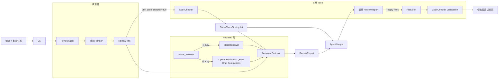
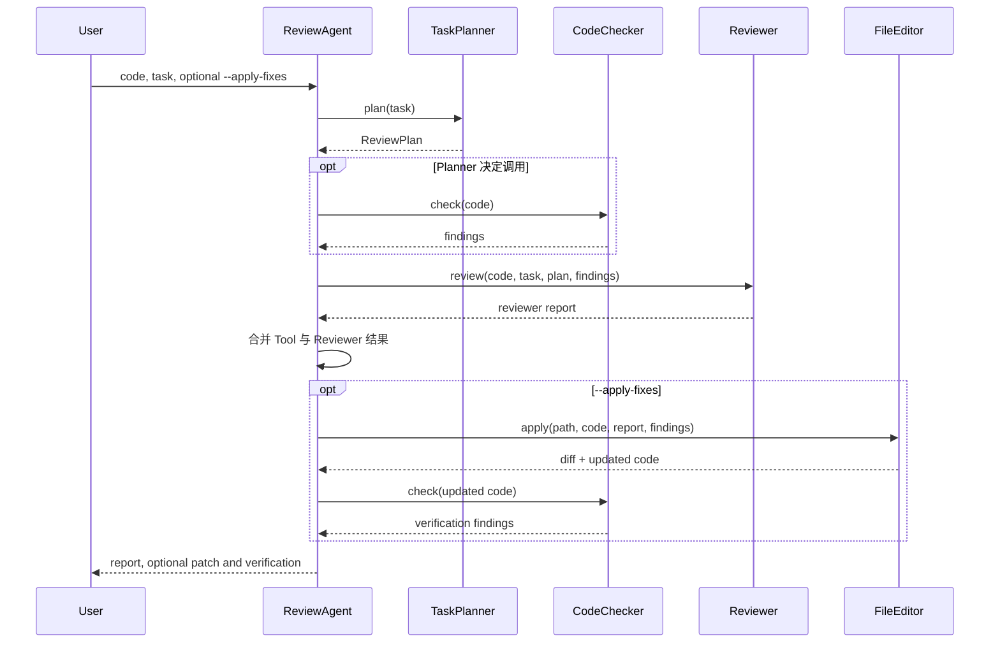
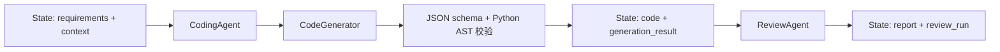
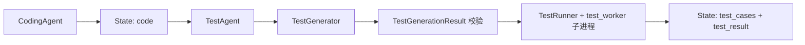
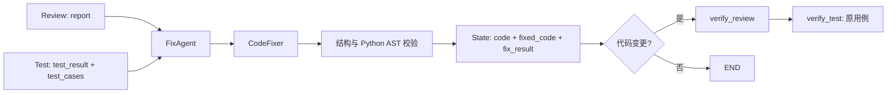
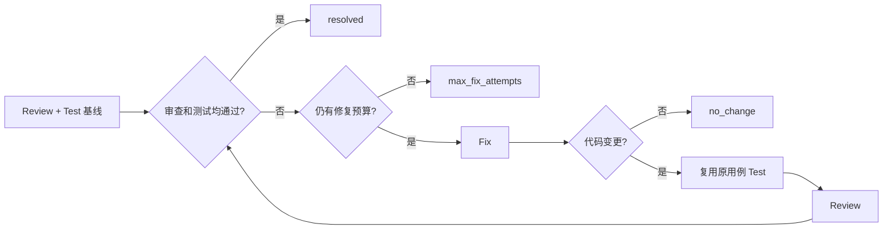

# Design: Python Code Review Agent

## 1. 目标

本项目演示一个最小但工程边界清晰的代码审查 Agent：

1. 接收 Python 源码和自然语言审查任务。
2. 由 Planner 决定是否需要本地静态工具。
3. 合并确定性 Tool 结果与可替换 Reviewer 结果。
4. 在用户显式授权时生成并应用保守补丁。
5. 修改后重新验证，形成可测试的闭环。
6. 无 API Key 时完整离线运行。

非目标：替代成熟 linter、执行不可信代码、自动修复所有问题，或在没有明确参数时修改文件。

## 2. 总体架构

核心设计原则是“确定性 Tool 结果不依赖 LLM”。CodeChecker 的发现由 Agent 直接转换成最终问题，Reviewer 只能补充，不能吞掉或覆盖这些结果。

## 3. 审查时序

## 4. 模块说明

| 模块 | 核心类型/入口 | 设计职责 |
| --- | --- | --- |
| `main.py` | `main()` | 解析 CLI、读取代码、控制是否写文件、统一错误输出和退出码 |
| `agent.py` | `ReviewAgent`、兼容 `CodeReviewAgent`、`ReviewRun`、`ReviewAndFixRun` | 单一编排入口，维持 Tool/Reviewer 独立性，合并结果并触发复检 |
| `planner.py` | `TaskPlanner`, `ReviewPlan` | 将任务文本映射为透明、确定性的 Tool 调用决策 |
| `code_checker.py` | `CodeChecker`, `CodeCheckFinding` | 仅使用 AST 的本地静态分析，不执行代码 |
| `file_editor.py` | `FileEditor`, `GeneratedPatch`, `FileEditResult` | 白名单式生成 diff、检查文件新鲜度、应用补丁 |
| `llm.py` | `Reviewer`, `MockReviewer`, `OpenAIReviewer`, `parse_review_report()` | 定义 Reviewer 边界，调用千问 OpenAI 兼容 Chat API，并将 JSON 校验为报告 |
| `prompt.py` | `SYSTEM_PROMPT`, `build_review_input()` | 将任务、Plan、源码和 Tool 结果组织成 LLM 上下文 |
| `models.py` | `ReviewIssue`, `ReviewReport` | 统一结构化输出和终端渲染 |
| `benchmarks/` | `BENCHMARK_CASES`, `run_benchmark()` | 确定性回归任务及 CI 退出码 |

## 5. Planner 决策

TaskPlanner 使用可解释关键词规则，而不是额外调用 LLM：

| 任务意图 | CodeChecker | 理由 |
| --- | --- | --- |
| 全面审查、语法、错误、异常、安全、正确性、可靠性 | 调用 | AST 可发现确定性运行问题 |
| 仅解释、总结、风格、命名、注释、文档、可读性 | 跳过 | 静态正确性检查与任务焦点无关 |
| 同时包含风险与风格 | 调用 | 风险意图优先，避免漏检 |
| 未知或模糊 | 调用 | 本地检查成本低，默认安全回退 |

`ReviewPlan` 会传递给 Reviewer，并写入最终摘要，便于测试和审计。

## 6. CodeChecker

CodeChecker 调用 `ast.parse()`，当前规则：

- `syntax-error`：捕获 `SyntaxError` 并转成 high 问题。
- `bare-except`：查找 `ast.ExceptHandler.type is None`。
- `division-by-zero`：检查 `/`、`//`、`%` 的右操作数是否为数字零常量，支持 `+0`、`-0.0`。

检查过程不导入、不编译、不执行被审查代码。规则输出包含 rule ID、行号、严重程度、原因和建议。

## 7. Reviewer 与 Mock 模式

`Reviewer` Protocol 隔离 Agent 与供应商实现。输入包括：

- 原始代码；
- 用户任务；
- Planner 决策；
- CodeChecker 结果（如果调用）。

`create_reviewer()` 根据 `.env` 自动路由：

- 缺少、为空或仍是占位 `DASHSCOPE_API_KEY`/`OPENAI_API_KEY`：`MockReviewer`；
- 有效配置：`OpenAIReviewer`，通过千问 OpenAI 兼容接口工作。

配置优先读取 `DASHSCOPE_API_KEY`、`DASHSCOPE_BASE_URL`、`QWEN_MODEL`，并兼容旧的 `OPENAI_API_KEY`、`OPENAI_BASE_URL`、`OPENAI_MODEL`。默认模型为 `qwen-plus`，默认地址为 `https://dashscope.aliyuncs.com/compatible-mode/v1`；生产环境可换成与 API Key 地域一致的工作空间专属地址。

Mock 返回固定结构化结果，用于验证整个 Agent 流程。真实 Reviewer 调用 `chat.completions.create()`，设置 `response_format={"type": "json_object"}` 和非思考模式，然后读取 `choices[0].message.content`。`parse_review_report()` 先解析纯 JSON 或 JSON 代码围栏，再使用 Pydantic 严格校验 `ReviewReport`；空响应、截断、拒答、非法 JSON 和 schema 错误均转换为 `LLMReviewError`。Agent 始终直接合并本地 Tool 发现，因此 LLM 不会成为确定性结果的单点故障。

## 8. FileEditor 安全模型

自动修改需要显式 `--apply-fixes`，并只支持 `.py` 文件。

当前修复白名单：

- `bare-except`：`except:` → `except Exception:`。

拒绝自动修复：

- 语法错误：缺少足够上下文推断作者意图；
- 常量除零：合法分母或业务分支未知；
- 不在最终审查报告中的发现；
- 行号或源码格式与预期不一致；
- 审查后内容已变化的文件。

FileEditor 使用 `difflib.unified_diff` 生成可审计补丁。发生实际写入后，Agent 强制再次运行 CodeChecker。没有安全补丁时不写文件，也不会声称问题已解决。

## 9. 异常与退出码

| 场景 | 行为 |
| --- | --- |
| 空输入、文件不存在、错误扩展名 | 可读错误，退出码 2 |
| `--apply-fixes` 未提供文件 | 拒绝修改，退出码 2 |
| 文件在审查后变化 | 拒绝过期补丁，退出码 2 |
| API 认证、限流、网络或状态错误 | 包装为 `LLMReviewError`，退出码 1 |
| Ctrl+C | 退出码 130 |
| 成功审查或无可自动修复项 | 退出码 0 |

## 10. Benchmark 设计

`benchmarks/cases.py` 用字符串保存代码，因此可以安全包含无法编译的语法错误案例。每个 `BenchmarkCase` 定义：

- 稳定 ID；
- 人类可读说明；
- Python 代码字符串；
- 有序的预期 rule ID。

Runner 对实际和预期序列做精确比较，打印每个任务的 PASS/FAIL，并在失败时返回退出码 1。当前包含 6 个问题案例和 1 个干净基线。

## 11. 测试策略与结果

测试均可离线执行，覆盖：

- Mock/千问 OpenAI 兼容 Reviewer 路由；
- Chat Completions 参数、纯 JSON、代码围栏 JSON、非法 JSON、schema 错误和截断响应；
- Planner 调用、跳过、混合和模糊意图；
- AST 语法、裸 `except`、三种零除及误报基线；
- Agent 的 Tool 传递和报告合并；
- FileEditor diff、实际写入、复检、危险修复跳过和过期补丁保护；
- Benchmark 案例数量与所有预期。
- Coding 节点的需求/上下文传递、生成代码到审查节点的数据衔接、State 版本与历史、失败不提交状态；
- CodeGenerator 的配置选择、JSON/语法校验、截断/拒绝/空响应以及生成 CLI 的退出码。
- TestGenerator 的结构化输出校验、配置选择，以及真实子进程的成功、断言失败、运行错误、全部跳过、超时、输出截断、环境隔离和 Workflow 状态提交。
- Fix 反馈传递、服务和输出异常不提交代码、修复前结果保存、跳过无问题/无变化分支，以及原失败测试的实际复验。
- 自动修复的多轮收敛、修复次数上限、无进展停止、异常轮次记录、快照独立性、重复运行预算重置，以及原有单轮接口兼容性。

2026-10-08 在 Python 3.14.3 / Windows 上：

- `python -m unittest discover -s tests -v`：142 tests OK（包含原有 128 个测试，未修改原测试文件）；
- `python -m benchmarks.run`：7/7 cases passed；
- `python -m compileall -q .`：通过；
- 源码 CLI 帮助：通过。当前虚拟环境没有 `pip`，本轮未重新验证安装和 console scripts；真实 LLM 仅使用模拟响应验证。

GitHub Actions 会在 Python 3.10、3.12 上重复编译、离线测试和 Benchmark。远程结果需在仓库首次 push 后确认。

## 12. 扩展点

- 在 `CodeChecker` 中增加更多 AST Visitor 规则。
- 用配置文件或分类器替换 Planner 关键词，但保持 `ReviewPlan` 接口。
- 新增其他 LLM 供应商，只需实现 `Reviewer` Protocol。
- 为 FileEditor 增加带规则 ID 的白名单修复器，避免自由文本直接驱动写入。
- 扩展 Benchmark 到性能、安全和误报/漏报数据集。
- 接入 Ruff、Bandit 或 mypy，并将结果标准化为 `CodeCheckFinding`。

## 13. Workflow 框架

### Review 的任务范围与评分

`ReviewAgent.run()` 将当前需求、背景、测试结果和原用例组织为 `ReviewContext`，公共 `execute()` 由 `BaseAgent` 提供。`OpenAIReviewer.review_with_context()` 将该上下文加入模型输入；对未声明此扩展的旧 Reviewer，保留原调用签名。默认审查任务收敛为需求一致性、已有测试失败和明确代码问题。

`ReviewIssue` 增加 `category`、`scope`、`evidence`、`requirement_ref`，兼容旧字段；`ReviewReport` 增加非阻断 `recommendations`、Agent 计算的 `score` 与审查时的 `test_status`。`review_policy.py` 保留全部工具发现，将 improvement、out_of_scope 和未明确要求的安全标准转为建议。标准需要引用用户 requirements 或自定义 task 的对应要求；泛泛的密码引用与明确排除的规范不会授权新增任务范围。

需求、实际测试失败和明确要求的安全标准每项扣 40 分；明确代码缺陷按 critical/high/medium/low 扣 40/25/15/5 分，从 100 起计算且不低于 0。可选建议不扣分，实际测试失败即使被模型漏报也由 Agent 补成阻断项；未执行测试显示 not_run，不虚构通过或失败。

Workflow 的 `_resolved()` 仍检查实际阻断问题为空和测试通过，不以分数阈值替代验收。Fix 提示明确只处理 `report.issues` 与测试失败，不将 `report.recommendations` 当作扩展功能的依据；具体漏洞与代码缺陷不会因为测试通过而被豁免。仅有需求外标准建议且测试通过的流程可在 0 次修复后结束。

`workflow/` 将可复用的流程能力与代码审查领域逻辑分离：

- `Agent` Protocol 只要求 `name` 和 `execute(StateView) -> AgentResult`，第三方 Agent 无需继承基类。内置 `CodingAgent`、`ReviewAgent`、`FixAgent`、`TestAgent` 统一继承 `BaseAgent`：基类固定公共 `execute()` 模板，校验输入快照及返回契约，再调用子类的抽象 `run()`；`CodeReviewAgent` 作为 `ReviewAgent` 的兼容名称保留。
- `WorkflowState` 统一保存跨步骤数据、运行状态、当前步骤、错误和版本号，并以独立运行元数据保存阶段状态/历史、Agent 结果、测试结果历史、修复历史入口、迭代次数和结构化执行日志。Agent 只能读取 `StateView` 快照，通过 `AgentResult.updates` 返回变更，由 Engine 在步骤成功后一次性提交并生成 `StateChange` 记录；运行元数据不改变业务版本号。
- `WorkflowEngine` 支持固定 `next_step`、Agent 返回的动态 `next_step` 和基于提交后状态的 `router`。路由优先级依次为 Agent 决策、router、固定后继。
- `max_steps` 为循环流程提供硬上限；Agent 或 router 异常会包装为携带失败状态的 `WorkflowExecutionError`。
- `ReviewAgent` 保留原有 `review`、`review_detailed`、`review_and_fix` 接口，同时通过 `BaseAgent` 实现统一接口；`CodeReviewAgent` 兼容现有调用。`create_review_workflow()` 提供默认的一步审查流程，调用方可继续追加步骤。

## 14. Coding Agent

`coding_agent.py` 提供 `CodingAgent(BaseAgent)`，接口为 `execute(StateView) -> AgentResult`，也支持直接调用 `generate(requirements, context=...)`。代码生成与审查共用已有 LLM 配置，供应商实现通过 `CodeGenerator` Protocol 隔离。

数据流如下：

- `requirements` 必须是非空字符串，`context` 可选且必须为字符串。输入校验失败时不调用生成服务。
- `CodeGenerationResult` 要求 `code` 和 `summary` 两个字段；源代码必须非空且可通过 AST 解析，不接受只有注释的输出。AST 校验不执行代码，也不能证明业务正确性。
- `OpenAICodeGenerator` 使用已有 Chat Completions 请求形态，解析 JSON 并封装认证、限流、连接及输出校验错误为 `LLMGenerationError`。
- `MockCodeGenerator` 生成保存需求的固定形式示例，用于离线验证；输出说明明确标注未实现用户的业务功能。
- Coding 的状态更新仅包含 `code` 和 `generation_result`，由 Engine 统一提交与记录版本。生成失败不会覆盖旧代码，Engine 保留失败步骤和原因。
- `create_coding_workflow(coding_agent, review_agent=None, test_agent=None, fix_agent=None, max_fix_attempts=None)` 支持可选的 Review、Test 和 Fix 节点；指定修复次数参数时启用自动循环，最终输出属于最后实际执行的节点。
- CLI `--requirements` 与 `--context` 默认调用生成/审查两节点流程；`--run-tests` 启用 Test 节点并实际执行生成代码。

## 15. Test Agent

`TestAgent(BaseAgent)` 读取 State 中的 `code` 及可选 `requirements`、`context`，通过 `TestGenerator` 生成用例，再交给 `TestRunner` 执行。TestGenerator 使用现有 Qwen 配置；无有效 Key 时选择仅验证模块导入的 Mock。

- `TestCase` 包含唯一的 `test_` 名称及非空 unittest 方法体。执行器提供 `self`、`module` 和 `unittest`；真实生成提示要求正常、边界和异常用例。
- Test 节点再次验证供应商输出，再一次性提交 `test_cases`、`test_result` 和 `test_generation_result`。生成失败或执行器异常不覆盖旧结果。
- `test_feedback.py` 在 Test 提交前给失败和运行错误补充原测试名、方法体及字符串期望；结果同时保存按用例名组织的 `test_expectations`。提取器静态分析字面量和明确的局部常量，不运行测试表达式；精确、正则和子串断言保持区分，无法提取时仍传递原源码。
- State 中 `reuse_test_cases=True` 时，Test 节点校验并复跑已有测试，不调用 TestGenerator；该标记在复验提交后恢复为 False。
- 执行器在临时目录中保存被测代码和组装后的 `GeneratedTests`，启动当前解释器 `-I -B -X utf8` 运行仅依赖标准库的 `test_worker.py`。环境只保留 Windows 系统路径变量及临时目录变量，不继承 API Key。
- 默认超时 10 秒。超时后终止测试进程，在 Windows 使用 taskkill 清理进程树，在 POSIX 终止进程组；stdout/stderr 写入临时日志，返回结果每项最多保留 64 KiB。
- worker 通过 unittest 的实际计数和 traceback 构建结果，不解析日志判断成功。进程提前退出、结果缺失、数量不一致或全部跳过均不会报告通过。
- `test_result.status` 区分 `passed`、`failed`、`error`、`timeout`；包含计数、失败和错误详情、stdout/stderr、耗时与退出码。测试失败或超时是业务结果，Workflow 可正常完成并让后续 router 处理；生成或基础设施异常由 Engine 标记为 `FAILED`。
- `create_test_workflow()` 提供已有代码的单节点入口；Coding Workflow 支持 `coding -> test` 和 `coding -> review -> test`。
- CLI `--run-tests` 启用三节点流程，`--test-timeout` 设置时间上限；测试非通过状态返回退出码 1。

独立子进程并非操作系统安全沙箱。被测代码和生成用例仍具有当前用户的文件及网络访问权限；临时工作目录、精简环境和超时不构成权限隔离。

## 16. Fix Agent

`FixAgent(BaseAgent)` 读取当前 `code`、Review 的 `report`、Test 的 `test_result` 和可选的 `test_cases`、`requirements`、`context`。至少需要一份当前诊断结果。`CodeFixer` Protocol 隔离供应商；真实实现使用已有 Qwen 配置，返回与 Coding 相同的 `CodeGenerationResult`，由 Fix 节点再次执行结构和 AST 校验。

- 没有审查问题且测试通过时不调用修复服务。测试失败、运行错误和超时均视为可处理反馈；修复提示要求遵守原需求、不修改测试、不绕过断言。
- `FixRun` 保存原代码、输出代码、说明、unified diff、`changed` 和 `skipped`。这些字段由 Agent 根据实际输出计算，模型不能自行宣称已修改或已通过测试。
- Agent 成功后原子提交 `code`、`fixed_code`、`code_before_fix`、`fix_result`、`fix_changed`。API 错误或输出无效不改变原代码和诊断。
- 代码变更时保存 `report_before_fix`、`review_run_before_fix`、`test_result_before_fix`，并清空当前诊断。原有测试用例保持不变，存在原用例时设置 `reuse_test_cases=True`。
- Coding Workflow 的原有单轮模式至少要有一个反馈节点。变更后的代码由已配置的 Review/Test 节点执行一次复验；没有变更则直接结束。启用自动循环需要全部 Review/Fix/Test 节点，详见下一节。
- `create_fix_workflow()` 是单节点入口，更新 State 后由调用方决定后续复验。`generation_result` 保留初始 Coding 产物，当前源代码应从 `code` 读取。
- Mock Fixer 复用 `FileEditor.generate_patch()`，只生成白名单式裸 `except` 修改，不调用写文件接口。真实 Fixer 返回完整代码，修复是否有效由复验确认。
- Fix 请求额外提供 `test_contract` 和 `failed_test_contexts`，保留原测试的期望文案，即使调用方只有已保存的失败结果。修复提示要求保留消息原文，识别正向/否定及精确/正则/子串语义；密码校验顺序明确为基础类型/空值、弱密码、长度/复杂度，禁止用复杂度错误覆盖弱密码提示。
- register_user 的复杂度约束为 `has_special and other_categories >= 2`，其中另两类从大写、小写、数字中计数，空白不作为特殊字符。最小长度 8 和原错误文案保持不变；Test Agent 实际执行的 12 个组合覆盖了边界条件。
- CLI `--fix-code` 默认启用单轮修复和复验；增加 `--max-fix-attempts` 与 `--run-tests` 可启用自动循环。结果写入 State 并打印，与已有文件写入 `--apply-fixes` 分开。

### Fix 内部语法重试

`GeneratedCodeSyntaxError` 标记模型校验中的 Python 语法失败，Pydantic 的结构化诊断保留该类型和错误草稿。解析层传递 `LLMCodeSyntaxError`，修复供应商转换成 `LLMFixSyntaxError`，使 Fix Agent 可与普通服务/格式错误区分。注入的供应商返回无效模型或直接抛出对应 ValidationError 时也使用相同分类。

Fix Agent 默认在首次生成失败后最多再试 3 次，共最多 4 次代码生成调用。每次在原 context 后补充上次语法错误和无效草稿，原代码、需求、Review/Test 反馈保持一致。AST 校验之后还执行 `compile(..., 'exec')`，识别函数外 return 等 AST 可解析但不可编译的代码，校验不执行源代码。

重试属于同一次 Fix 节点执行；只有最终有效代码生成 diff 并一次性提交 State，所有调用耗时计入该节点。Workflow 的步骤顺序、State 更新次数和修复轮数不因内部重试增加。成功的 `FixRun` 记录 `generation_attempts` 与 `syntax_errors`；无问题跳过时生成次数为 0。重试耗尽保留原代码和诊断，通过原异常机制标记失败，非语法的服务/JSON/schema 错误立即按原机制报错。

## 17. 自动修复循环

`workflow/repair.py` 提供 `RepairWorkflowEngine(WorkflowEngine)` 和 `create_repair_workflow()`。底层仍使用现有 Engine 的步骤执行、路由、State 原子提交和异常封装；阶段包装器将预算与轮次记录合并进对应 Agent 的状态更新。原单轮工厂的默认参数、步骤顺序和版本计数保持兼容。

- `max_fix_attempts` 默认 3，允许非负整数，0 表示仅诊断。`fix_attempts` 统计实际进入 Fix 阶段的次数，包括无变化和异常的尝试；Review/Test 次数不占修复预算。
- 初次 Review/Test 形成基线反馈，后续按 `Review -> Fix -> Test -> Review` 迭代。新 Fix 读取当前代码与上轮最新的审查和测试结果；原测试用例始终复用。
- 成功要求 Review 无问题、Test 为 `passed` 且存在实际通过的测试；最后一次允许的修复若通过，优先标记 `resolved`。未通过且次数用完为 `max_fix_attempts`，没有代码变化为 `no_change`。
- 每个阶段生成 `RepairDecision`，以 Review/Test 的独立通过状态、预算、代码是否变化为条件选择 `test`、`review`、`fix` 或 `END`；决策原因随 State 保存并写入 `repair.decision` 执行日志。
- `repair_history` 是按尝试顺序保存的 `RepairRound` 元组，包括原代码、输出代码、修复前后诊断快照、修复输出/diff、状态与 `RepairStepExecution`。步骤记录 Agent、State 版本、耗时、输出和错误；后续阶段不会修改早先记录。
- 顶层 `StageState`、`AgentResultRecord` 和 `ExecutionLog` 使用 `repair_round` 关联基线（0）及每次修复（从 1 开始），`logs_for_round()` 可直接还原单轮 Agent、状态提交、路由和终止判断。
- `active_repair_round` 保存 Fix 之后尚未完成复验的轮次。阶段异常时，Engine 保留原异常链，追加包含部分步骤和错误的轮次，标记 `repair_stop_reason=error` 和 `repair_succeeded=False`，同时保留之前完成的记录。
- 每次 `run()` 初始化独立计数和历史，不采用初始 State 传入的计数来控制预算。同一 Engine 可执行多个独立 State，终态 State 仍不能重新启动。
- 预算耗尽或无进展是正常结束条件，Workflow 为 `COMPLETED`；Agent 异常为 `FAILED`。调用方用 `repair_succeeded` 判断任务是否解决，而非只看生命周期状态。
- 循环的 `max_steps` 按修复预算设置足够的容量，同时保留通用步骤上限，避免较大预算被原默认 100 步提前截断。
- Coding Workflow 通过 `max_fix_attempts` 参数接入循环；CLI 通过 `--max-fix-attempts N` 接入并显示每轮记录。循环未解决问题时返回退出码 1，即使测试通过但审查仍有问题。

## 18. Workflow Report

`workflow/report.py` 从终态 `WorkflowState` 生成不可变的 `WorkflowReport`。正常执行通过 `WorkflowRun.report` 访问，异常执行通过 `generate_workflow_report(error.state)` 访问；运行中的 State 被拒绝，避免把中间快照误标为最终结论。

报告同时保留聚合视图和原始证据：`StageReport` 汇总每个阶段的最终状态、调用次数、耗时和错误，原始 `StageState`、`AgentResultRecord`、测试历史、`RepairRound` 与 `ExecutionLog` 仍按顺序保存。`WorkflowOutcome` 将执行状态与业务验收分离：引擎异常为 `failed`，Review/Test 或修复结论未通过为 `unresolved`，其余完成态为 `succeeded`。`to_dict()` 递归处理 dataclass、Enum、UTC 时间、Pydantic 模型和只读映射，输出 JSON 兼容结构。

## 19. 已知限制

- 规则集刻意保持最小，不能替代生产级静态分析器。
- Planner 依赖关键词，无法理解复杂隐含意图。
- Mock 输出固定，不评估输入代码的高层语义。
- FileEditor 不根据自由文本建议任意生成代码，这是为了控制自动写入风险。
- 真实 LLM 输出即使符合 schema，也仍可能存在判断错误。
- 当前 Workflow Engine 是进程内同步执行器，不提供持久化、分布式调度或断点恢复。
- Coding Agent 当前输出单份 Python 源代码，不生成多文件工程；运行由可选 Test 节点负责，需求完成程度依赖模型和测试覆盖范围。
- Test Agent 不自动安装生成代码的第三方依赖；依赖需已存在于执行解释器环境中，Mock 仅验证导入而非业务功能。
- Fix 当前只处理单份 Python 源代码；单轮模式和有次数上限的循环均不能保证问题解决，应检查最终报告、测试状态和 `repair_succeeded`。
- register_user 回归使用模拟模型响应与真实测试子进程，验证两轮修复后原有 10 个注册用例通过；不声称未保存的历史 Demo 或真实模型调用已通过。
