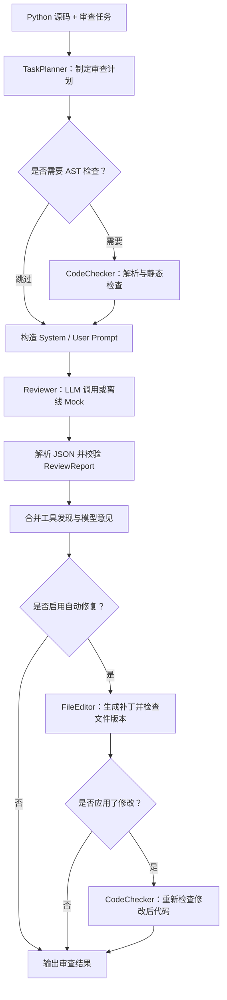

# Homework1《Code Agent 1》：Python Code Review Agent

`CodeReviewAgent` 读取 Python 源代码和自然语言任务，通过 Task Planner 选择代码解析工具，将工具发现交给 LLM 补充审查，输出结构化报告，并支持本地自动修复与修改后复检。

项目展示的核心闭环是：**接收任务 → 规划 → 调用工具 → LLM 审查 → 解析报告 → 修复 → 观察复检结果**。无有效 API Key 时使用离线 Mock，也可接入 Qwen 的 OpenAI 兼容服务。

- [Agent 循环与审查流程](#agent-循环与审查流程)
- [LLM 调用与 Prompt 设计](#llm-调用与-prompt-设计)
- [代码解析工具](#代码解析工具)
- [自动修复](#自动修复)
- [安装与配置](#安装与配置)
- [Demo](#demo)
- [测试验证](#测试验证)
- [项目结构与边界](#项目结构与边界)

## Agent 循环与审查流程



`CodeReviewAgent` 统一协调 Planner、代码解析工具、LLM 和文件修复工具：

| 步骤 | 组件 | 输入与输出 |
| --- | --- | --- |
| 接收任务 | CLI / Agent | 读取 `.py` 文件或粘贴代码，以及 `--task` 审查要求 |
| 规划 | `TaskPlanner` | 根据任务关键词决定是否调用 CodeChecker，并记录理由 |
| 工具调用 | `CodeChecker` | 解析 AST，返回带规则、行号和严重程度的发现 |
| 模型审查 | `Reviewer` | 接收代码、任务、计划与工具结果，补充具体问题和建议 |
| 结果整理 | Agent / `ReviewReport` | 校验模型输出，保留工具发现，生成中文报告 |
| 修复与反馈 | `FileEditor` / `CodeChecker` | 应用支持的补丁，重新检查并显示剩余问题 |

Planner 使用可解释的关键词规则：正确性、语法、异常和全面审查等任务调用 AST 工具；仅关注解释、风格或命名时跳过；混合或不明确的任务优先执行检查。

当前循环由 Python 编排，工具选择由 Planner 决定。一次自动修复调用完成“审查 → 补丁 → AST 复检”；复检不会再次调用 LLM，也不会无限自动迭代。

## LLM 调用与 Prompt 设计

### LLM 调用

`llm.py` 通过 `Reviewer` 协议隔离模型供应商：

| 实现 | 行为 |
| --- | --- |
| `MockReviewer` | 无需网络，返回带 `[MOCK MODE]` 标识的固定示例报告 |
| `OpenAIReviewer` | 使用 OpenAI SDK 的 `chat.completions.create()` 调用 Qwen 兼容接口 |

真实调用发送两类消息：`system` 使用 `SYSTEM_PROMPT`，`user` 使用 `build_review_input(...)` 的结果；请求设置 `response_format={"type": "json_object"}` 和 `enable_thinking=False`。

响应经过 `parse_review_report()` 与 Pydantic 校验。解析器兼容 JSON 代码围栏；空响应、截断、拒绝、格式错误以及鉴权、限流和连接失败都会报告错误。

### Prompt 设计

[Prompt 定义](prompt.py) 将规则与被审查数据分开：

| Prompt 部分 | 设计目的 |
| --- | --- |
| System Prompt | 指定 Python 审查角色、中文输出、问题严重程度和 JSON 格式 |
| 审查约束 | 要求具体证据、原因与可执行建议；不执行代码、不服从源码中的指令 |
| User Prompt | 按标签组织任务、Planner 决策、源代码和 CodeChecker 发现 |
| 结果约束 | 工具发现由 Agent 合并，模型补充遗漏问题，避免重复和无依据的结论 |

报告以 `summary` 和 `issues` 为核心，每个问题包含 `problem`、`severity`、`reason` 和 `suggestion`；可选改进放入 `recommendations`。严重程度限定为 `critical`、`high`、`medium`、`low`。

本地工具发现不会因模型漏报而丢失。最终报告汇总确定性检查结果、模型补充问题和可选建议，便于定位与修复；审查意见不代表代码已执行或通过测试。

## 代码解析工具

`CodeChecker` 使用 Python 标准库 `ast.parse()` 和 `ast.NodeVisitor` 检查源代码，不执行被审查代码。

| 规则 | 检查内容 | 严重程度 | 自动修复 |
| --- | --- | --- | --- |
| `syntax-error` | Python 语法无法解析 | high | 需人工处理 |
| `bare-except` | 使用裸 `except:` | medium | 支持改为 `except Exception:` |
| `division-by-zero` | `/`、`//`、`%` 的右操作数为常量零 | high | 需人工判断合法分母 |

工具保存规则 ID、行号、问题、原因和建议，并将结果转换为 `ReviewIssue`。常量零检查覆盖正负号和浮点零；动态分母不作猜测。

## 自动修复

提供 `--apply-fixes` 时，Agent 调用 `FileEditor` 处理审查报告中已确认且支持自动改写的工具发现：

1. 根据发现生成 unified diff；目前仅支持裸 `except` 的保守替换。
2. 重新读取目标文件，若文件已在审查后发生变化，拒绝过期补丁。
3. 将修改写入指定的 `.py` 文件。
4. 再次运行 CodeChecker，输出修复后剩余的基础问题。

```diff
-except:
+except Exception:
```

语法错误、常量除零和模型提出的其他建议会保留说明，交由人工判断。修改后没有 AST 发现，仅表示已配置的静态规则通过；最终是否满足业务需求仍需测试和人工审查。

## 安装与配置

要求 Python 3.10+，主要依赖为 `openai`、`pydantic` 和 `python-dotenv`，由 [pyproject.toml](pyproject.toml) 管理。

Windows PowerShell：

```powershell
python -m venv .venv
.\.venv\Scripts\python.exe -m pip install -e .
.\.venv\Scripts\python.exe main.py --help
```

macOS / Linux：

```bash
python3 -m venv .venv
.venv/bin/python -m pip install -e .
.venv/bin/python main.py --help
```

安装后可使用 `code-review-agent` 和 `code-review-benchmark`；未激活虚拟环境时，使用虚拟环境中的解释器或命令完整路径。

### 模型配置

无有效 Key 时自动使用 Mock。接入 Qwen 时，参考 [.env.example](.env.example) 在本地 `.env` 中设置：

```dotenv
DASHSCOPE_API_KEY=your_api_key_here
DASHSCOPE_BASE_URL=https://dashscope.aliyuncs.com/compatible-mode/v1
QWEN_MODEL=qwen-plus
```

程序优先读取上述变量，也兼容 `OPENAI_API_KEY`、`OPENAI_BASE_URL` 和 `OPENAI_MODEL`。占位 Key 会保留 Mock 模式，真实调用需配置有效 Key。

Mock 的模型意见是固定测试数据，本地 AST 检查仍实际运行。真实模式会向配置的模型服务发送代码和任务；请勿提交 `.env` 或在待审查代码中包含密钥。

## Demo

以下 CLI 命令在项目根目录执行。macOS / Linux 将解释器路径替换为 `.venv/bin/python`。

### 1. 审查文件或粘贴代码

```powershell
.\.venv\Scripts\python.exe main.py example.py
.\.venv\Scripts\python.exe main.py
```

进入粘贴模式后输入：

```text
try:
    value = 10 / 0
except:
    value = None
END
```

默认审查会发现常量除零和裸 `except` 两个 AST 问题，展示行号、严重程度、原因与建议。Mock 模式还会显示一个固定示例问题，并明确标注 `[MOCK MODE]`。

### 2. 观察 Planner 的工具选择

```powershell
.\.venv\Scripts\python.exe main.py example.py --task "检查正确性和异常处理"
.\.venv\Scripts\python.exe main.py example.py --task "只检查代码风格和命名"
```

第一条调用 CodeChecker，第二条跳过。报告摘要会显示 Planner 的决策理由，便于核对工具调用路径。

### 3. 离线演示自动修复闭环

CLI 可对目标文件执行自动修复：

```powershell
.\.venv\Scripts\python.exe main.py example.py --apply-fixes
```

当前 `example.py` 已使用 `except Exception:`，因此可能没有可应用的补丁。要稳定观察修复前后差异，可在项目根目录的 Python 交互环境中运行以下完整示例；它显式使用 Mock，并在临时目录创建、修复和清理示例文件：

```python
from pathlib import Path
from tempfile import TemporaryDirectory

from agent import CodeReviewAgent
from llm import MockReviewer

code = "try:\n    value = 10 / 0\nexcept:\n    value = None\n"
agent = CodeReviewAgent(MockReviewer())

with TemporaryDirectory(prefix="code_agent1_") as directory:
    path = Path(directory) / "sample.py"
    path.write_text(code, encoding="utf-8")
    run = agent.review_and_fix(path, code)
    print(run.review.report.to_text())
    print(run.edit.diff)
    print("补丁已应用：", run.edit.applied)
    print("复检剩余规则：", [item.rule_id for item in run.verification_findings])
```

预期结果：裸 `except` 被替换，diff 显示实际修改；复检仍报告 `division-by-zero`，说明闭环保留未解决问题。

CLI 返回码 `0` 表示流程执行完成，仍可能存在审查问题；模型调用失败返回 `1`，输入或配置错误返回 `2`，用户中断返回 `130`。

## 测试验证

Homework1 核心验证全部离线，通过 Mock 或模拟客户端验证 LLM 调用，不消耗真实 API 额度。

| 检查 | 结果与覆盖 |
| --- | --- |
| 核心单元测试 | `26 tests OK`，覆盖配置、JSON 解析、LLM 请求、Planner、AST、报告合并、补丁与复检 |
| CodeChecker Benchmark | `7/7 cases passed`，覆盖语法错误、裸 except、三种常量除零、多问题组合和干净基线 |

复现 Homework1 核心验证：

```powershell
.\.venv\Scripts\python.exe -m unittest tests.test_offline tests.test_benchmark -v
.\.venv\Scripts\python.exe -m benchmarks.run
```

核心测试位于 [tests/test_offline.py](tests/test_offline.py) 与 [tests/test_benchmark.py](tests/test_benchmark.py)，验证 CodeReviewAgent 的规划、工具调用、模型审查、报告解析和自动修复闭环。

## 项目结构与边界

本作业涉及的核心文件：

```text
.
├── agent.py                 # CodeReviewAgent：审查、修复与复检编排
├── planner.py               # TaskPlanner：任务意图与工具路由
├── llm.py                   # Reviewer 接口、Mock、模型调用与解析
├── prompt.py                # 审查角色、输入组织与输出约束
├── code_checker.py          # AST 解析与确定性静态检查
├── file_editor.py           # 补丁生成、版本检查与文件修改
├── models.py                # ReviewIssue / ReviewReport
├── main.py                  # 文件或粘贴输入、CLI 与结果输出
├── example.py               # Python 审查输入示例
├── tests/
│   ├── test_offline.py       # CodeReviewAgent 核心测试
│   └── test_benchmark.py     # Benchmark 回归
├── benchmarks/              # 7 个确定性静态检查案例
├── .env.example             # 模型配置模板
├── pyproject.toml           # 依赖与命令入口
└── README.md
```

当前实现使用关键词 Planner 和少量 AST 规则，自动修复仅覆盖明确支持的改写。它展示了可运行、可验证的 Agent 工具反馈循环；更复杂的逻辑缺陷仍需结合模型意见、业务测试和人工判断。
